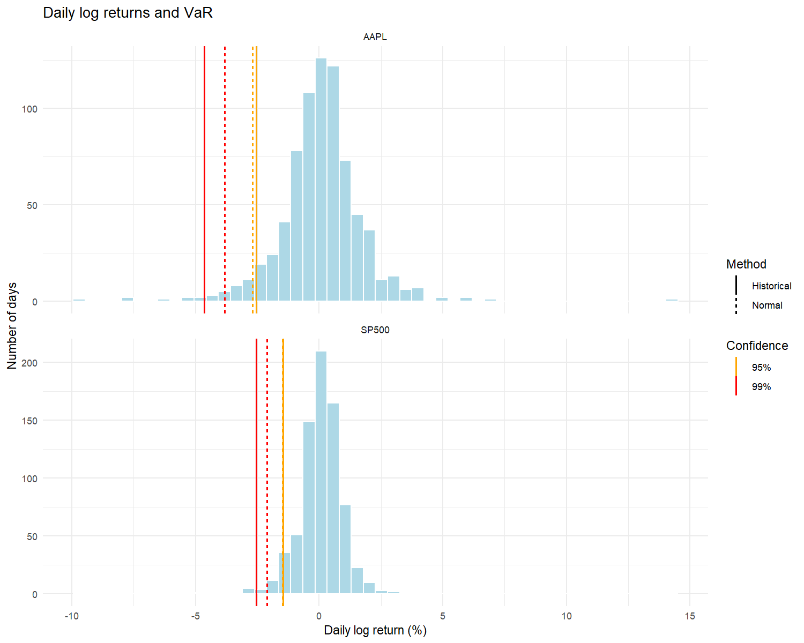

# risk-management-hw1
# Практичне заняття №2
## Розрахунок Value at Risk та Expected Shortfall в R

Для аналізу обрано акції Apple (AAPL) та індекс S&P 500 (^GSPC).
Щоденні котирування завантажено з Yahoo Finance за останні три роки
на дату виконання роботи — 11.10.2026.

Використано скориговані ціни закриття та логарифмічні щоденні
дохідності. Після видалення пропущених значень отримано
751 спостереження для кожного активу.

## Результати

Показники наведено як додатні величини одноденних втрат
у відсотках логарифмічної дохідності.

| Актив | Історичний VaR 95% | Історичний VaR 99% | Нормальний VaR 95% | Нормальний VaR 99% | Історичний ES 95% |
|---|---:|---:|---:|---:|---:|
| Apple (AAPL) | 2,547% | 4,634% | 2,682% | 3,828% | 3,910% |
| S&P 500 | 1,467% | 2,533% | 1,471% | 2,112% | 2,143% |

## Висновок

За всіма розрахованими показниками Apple має більший одноденний
ризик, ніж індекс S&P 500.

Історичний VaR 95% для Apple становить 2,547%, а для S&P 500 —
1,467%. Це оцінені пороги втрат, перевищення яких відповідає
нижнім 5% розподілу щоденних дохідностей.

Історичний ES 95% становить 3,910% для Apple та 2,143% для S&P 500
і характеризує середні втрати у найгірших 5% спостережень.

На рівні 99% історичний VaR перевищує нормальний VaR для обох
активів. Це свідчить, що нормальна модель оцінює крайні втрати
нижче, ніж історичний метод на цій вибірці.

VaR не є гарантованою максимальною втратою: фактичні майбутні
втрати можуть перевищувати розрахований поріг.

## Графік

Суцільні лінії відповідають історичному методу, пунктирні —
нормальному. Помаранчеві лінії показують VaR 95%, червоні — VaR 99%.



## Запуск аналізу

Відкрити проєкт у RStudio та виконати в Console:

```r
source("scripts/main_analysis.R", encoding = "UTF-8")